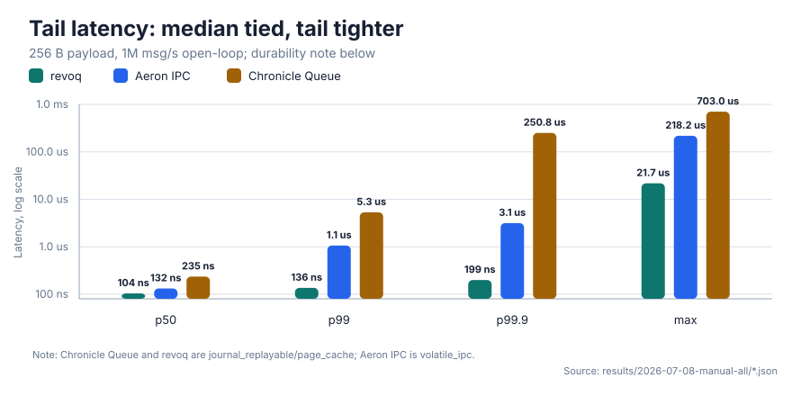
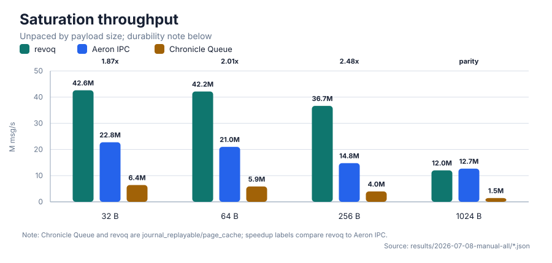
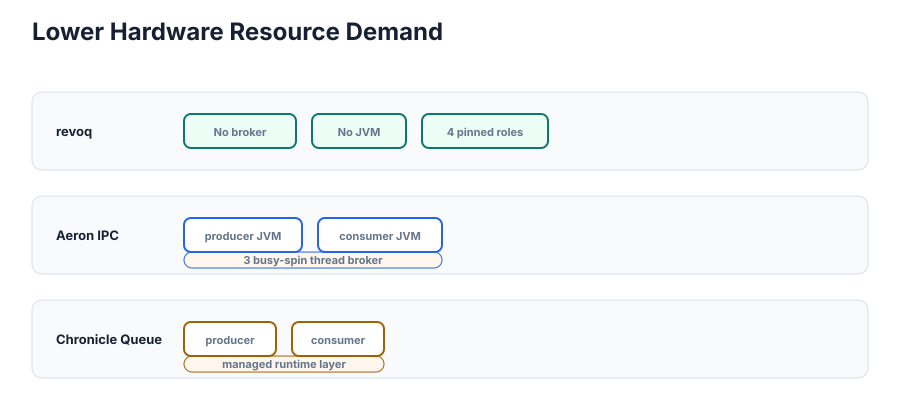

# revoq

[](https://github.com/revoracer/revoq/actions/workflows/ci.yml)
[](CHANGELOG.md)
[](#quick-start)
[](#quick-start)
[](LICENSE)

Open-source, file-backed, memory-mapped **IPC stream** for low-latency
same-host messaging and replay.

## At a glance

- Open-source transport primitive behind [RevoRacer](https://revoracer.com)
  infrastructure, published so the memory model, file format, benchmarks, and
  failure semantics are inspectable.
- Same-host IPC for market data, execution events, strategy signals, and
  telemetry.
- Local event movement for AI-agent infrastructure that needs replayable,
  low-jitter handoff between model workers, tool adapters, policy gates, and
  execution services.
- One hot-path writer per stream, many independent readers; slow readers do not
  stall the writer.
- Release/acquire publication: payload first, `length` last.
- Header-only C++23 revoq layer, optional Python bindings, Linux tuned path,
  Apache-2.0 license.

## Why this repo exists

RevoRacer builds low-latency infrastructure for systems where the tail matters:
trading data paths, execution gateways, and same-host services that cannot hide
behind broker latency or runtime jitter. `revoq` is open source because
credibility in this domain should come from code, memory-ordering rules,
benchmark methodology, reproducible artifacts, and clear limits.

The same pressure is now showing up in AI-agent systems. Once agents call tools,
coordinate workers, pass through approval or risk gates, and trigger real-world
actions, the platform needs more than orchestration glue. It needs auditable
event history, deterministic replay, process isolation, and predictable local
handoff. `revoq` is not an agent framework; it is a transport/journal primitive
for the hot same-host links where queues, sockets, brokers, or managed runtimes
can add avoidable tail latency.

## Design limits

revoq targets one latency-sensitive producer publishing committed frames to
independent same-host consumers. The limits are intentional:

- **Not a network transport.** revoq is same-host IPC over mapped files.
- **Not lock-free MPSC.** The multi-writer policy serializes writers.
- **Not a latency guarantee on an untuned box.** Portable mode is for functional
  checks; the tail-latency story requires Linux, isolated cores, and hugepages.
- **Not yet API-stable.** This is `0.1.0`; signatures may still change.

## Architecture


`Appender` appends aligned frames to memory-mapped segment files;
`MergingCursor` joins streams and reads committed frames. Each frame carries
`length` (published last), message metadata, timestamps, and payload bytes.

A single `MergingCursor` can join several streams at once and present their
committed frames as one sequence ordered by `gen_time`, earliest first:


See [docs/architecture.md](docs/architecture.md),
[docs/memory_model.md](docs/memory_model.md), and
[docs/file_format.md](docs/file_format.md).

## Correctness

The core publication rule is tested directly: reserve a slot, fill metadata and
payload, release-store `length`; acquire-load `length`, then read the committed
frame.

Tests cover publication ordering, multiprocess handoff, resume/recovery, frame
and reader behavior, hugepages, typed dispatch, and Python round trips.

```bash
CXX=/usr/bin/clang++-20 ./build.sh test
```

## Quick start

Requirements: Linux (recommended for latency work), CMake ≥ 3.23, a C++23
compiler such as Clang 20, and Git submodules for the bundled deps (`revobase`,
`fmt`, `spdlog`, `Catch2`, `pybind11`).

```bash
CXX=/usr/bin/clang++-20 ./build.sh            # build
CXX=/usr/bin/clang++-20 ./build.sh test       # run C++ tests
CXX=/usr/bin/clang++-20 ./build.sh examples   # build C++ examples
CXX=/usr/bin/clang++-20 ./build.sh python     # build + test Python bindings
```

### Library shape

`revoq` itself is header-only: the stream, appender, cursor, frame, and
dispatcher APIs live under [`include/revoq/`](include/revoq). The build still
links compiled support code from [`revobase`](external/revobase) for mmap,
hashing, time, affinity, and realtime helpers.

For CMake consumers, link the target and let it carry the transitive
dependencies:

```cmake
add_subdirectory(revoq)
target_link_libraries(my_app PRIVATE revoq::revoq)
```

### Write and read (C++)

```cpp
using namespace racer::revoq;

struct Trade { std::int64_t ts; std::uint32_t symbol_id; double price; std::uint64_t qty; };

auto locator  = std::make_shared<Locator>(dir);
auto location = Location::make(Mode::LIVE, Category::EXECUTION, "examples", "demo", locator);

// writer: fill the slot, then publish
Appender<> writer(location, /*dest_id=*/0,
    AppenderOptions{.prefault = false, .background_threads = false});
auto &slot = writer.openData<Trade>(/*gen_time=*/1, MsgType::Trade);
slot = Trade{1, 101, 100.25, 10};
writer.closeData<Trade>();

// reader: walk committed frames
MergingCursor reader(MergingCursorOptions{.prefault = false, .background_threads = false});
reader.join(location, /*dest_id=*/0, 0);
while (const auto frame = reader.tryCurrentFrame()) {
  if (static_cast<MsgType>(frame.msg_type) == MsgType::Trade)
    use(frame->data<Trade>());
  reader.advance(frame);
}
```

### Write and read (Python)

```python
import revoq, struct
location = revoq.make_location(path, mode="live", category="executiondata",
                               group="examples", name="demo")

writer = revoq.Appender(location, 0, prefault=False, background_threads=False)
writer.write(msg_type=100, gen_time=1, data=struct.pack("<Qd", 1, 100.0))
del writer

reader = revoq.MergingCursor(prefault=False, background_threads=False)
reader.join(location, 0, 0)
frames = [f for f in reader if f.msg_type == 100]
```

Runnable versions live in [`examples/`](examples). Each C++ example exits nonzero
on failure and prints an `ok ...` line on success.

## Benchmarking

The latency benchmark can run in portable or tuned mode.

The tuned path uses four pinned isolated logical roles: appender, cursor,
appender warmer, and cursor warmer. Public latency artifacts should include the
SMT sibling map so readers can verify whether those logical roles occupy
distinct physical cores.

**Portable mode** — no root, no pinning, no hugepages. Good for functional checks
and rough local comparisons. *Not* a source of host-to-host p99 claims.

```bash
CXX=/usr/bin/clang++-20 ./build.sh benchmarks
./build/revoq_benchmark_stream_handler_benchmark_p99 \
  --messages 1000000 --warmup 50000 --interval-ns 1000
```

**Tuned mode** — Linux only: explicit appender/cursor/warmer CPUs, real-time
priority, a `hugetlbfs` path, and a forked cursor process. Before your first
tuned run, prepare the host with `scripts/setup_benchmark_session.sh` — see
[docs/tuning_overview.md](docs/tuning_overview.md).

```bash
sudo ./build/revoq_benchmark_stream_handler_benchmark_p99 \
  --tuned --fork \
  --path <hugetlbfs>/revoq-bench \
  --appender-cpu 2 --cursor-cpu 4 \
  --appender-warmer-cpu 6 --cursor-warmer-cpu 8 \
  --rt-priority 80 \
  --messages 100000000 --warmup 50000 --interval-ns 100
```

**What is measured:** appender timestamp to cursor handler endpoint, over a
deterministic message stream at a configurable payload size (`--payload-bytes`
is 32, 64, 256, or 1024; default 32, uniform within a run). The benchmark
reports the distribution — `p50`, `p90`, `p99`, `p999`, `p9999`, `p99999`,
`max`, and `mean` in nanoseconds — plus the sustained producer rate
(`achieved_mps`), sample count, a checksum, and a lossless HdrHistogram encoding
(`latency_hdr_b64`) so the full distribution can be re-derived. In this domain
the tail is the number that matters, not the average.

### Publishing tuned results

Publish tuned results with the command, benchmark output, and host capture
together:

```bash
./scripts/check_system.sh
./scripts/collect_benchmark_env.sh > benchmark-env.txt
```

Published artifacts should preserve the material reproduction details: CPU
vendor/class, CPU topology, kernel, hugepage state, governor, memlock, compiler,
command shape, and output fields. Local checkout paths, hostnames, chassis
identifiers, exact CPU SKUs, and local filesystem paths can be redacted.

Use the four-role topology shown above for appender, cursor, appender warmer,
and cursor warmer, and publish the role-to-core mapping with the result. See
[docs/benchmarking.md](docs/benchmarking.md) and
[docs/tuning_overview.md](docs/tuning_overview.md) for the full methodology.

Current public appender-to-handler tuned artifact:

| Artifact | Measured span | Workload | Headline |
| --- | --- | --- | --- |
| [`2026-08-02-public-appender-to-handler-10mmsg-5x`](benchmarks/micro/results/2026-08-02-public-appender-to-handler-10mmsg-5x/README.md) | appender timestamp / intended-send time to cursor handler endpoint | 5 tuned runs, 10,000,000 measured messages per run, 32 B payload, 10M msg/s offered rate, four pinned roles verified by the published SMT sibling map | p99: 138-139 ns; p99.9: 217-219 ns |

The artifact includes benchmark stdout, command lines, host capture, and git
commit/tree-state capture with local filesystem paths redacted. For the 32 B
appender-to-handler path, it shows sub-150 ns p99 across five tuned 10M msg/s
runs on the captured host.

### Comparative benchmarks

revoq also ships drivers that place it beside Aeron and Chronicle Queue (OSS) on
one language-neutral workload, grouped by semantics **and durability** so a chart
can never mix incompatible cells. The JVM drivers are warmed to a **confirmed JIT
steady state** before measuring, so the numbers below are the fair, warm-JVM
figures — not a cold-start strawman.

The numeric charts are generated from the committed result JSON with
`benchmarks/comparative/harness/generate_readme_charts.py`; the committed JSON
keeps the headline values auditable.

The primary compatible cell is the non-durable shared-memory group
(`volatile_ipc`), against **Aeron IPC** on an isolated-core host
(5M msgs/point, open-loop). The charts also include **Chronicle Queue** as a
clearly marked durable `journal_replayable` / `page_cache` reference point:



The headline is simple: **median latency is effectively tied**, but revoq's
**tail is much tighter**. Across payload sizes, both systems land around
100–140 ns at p50; revoq stays near sub-150 ns p99 and sub-µs p99.9, while warm
Aeron IPC is around ~1 µs p99 and low-single-digit-µs p99.9. Depending on
payload and percentile, that is a **~7–15× tail-latency advantage**.

At saturation (unpaced), revoq sustains **~1.9–2.5×** Aeron IPC's throughput up
to 256 B, converging to parity at 1024 B where both are memory-bandwidth-bound:



revoq also keeps a replayable journal Aeron IPC does not — and it earns these
numbers with a **lighter runtime footprint**:



- **No broker process.** revoq's tuned path is one native process tree.
- **No managed runtime.** There is no JVM, GC, JIT, or safepoint machinery in the
  measured path.
- **Fewer moving parts.** revoq pins 4 isolated roles (appender, cursor, and two
  warmers). A clean Aeron IPC setup needs those application roles plus a
  **MediaDriver** process with three busy-spin threads; its Archive variant uses
  more. Chronicle is broker-less like revoq, but still carries the JVM runtime.

So the advantage is not just one number. In the compatible `volatile_ipc` cell,
revoq shows **tighter tail latency**, **higher saturation throughput up to
256 B**, and a **smaller runtime footprint**. At 1024 B throughput converges to
parity, where both systems are memory-bandwidth-bound. Full tables (all four
payload sizes, both rates, plus the durable `journal_replayable` group where
Chronicle's tail degrades sharply under load at large payloads), the committed
result JSON, and methodology notes live in
[benchmarks/comparative/](benchmarks/comparative/README.md#latest-results).

## Beyond Trading

revoq was built for latency-sensitive trading systems, but the same design
applies anywhere same-host processes need deterministic, high-throughput
handoff: memory isolation between components, low jitter, and replayable event
streams.

| Industry | What revoq can connect | Bottleneck reduced |
| :--- | :--- | :--- |
| **Robotics & autonomous vehicles** | Sensor, perception, planning, and control processes. | Scheduler and IPC jitter in critical handoff paths. |
| **Telecom & packet processing** | User-space networking stages, packet classifiers, and control-plane services. | Kernel-mediated IPC overhead between high-rate local stages. |
| **Databases & ingestion** | Network ingest, validation, indexing, and dedicated writer processes. | Ingest stalls caused by coupling network and storage work. |
| **Multimedia & audio** | Capture, AI inference, render, and audio-processing stages. | Frame drops and audio glitches from unpredictable local IPC latency. |
| **AI agents & automation** | Model workers, tool adapters, policy/risk gates, memory/indexing services, and execution adapters. | Broker/runtime jitter and weak replayability across local decision loops. |

If your architecture splits a hot workload across processes for isolation or
fault containment, local TCP, Unix sockets, and pipes can add jitter. revoq keeps
the handoff in shared memory and gives you a replayable mmap-backed journal.

### Deterministic replay

The same journal can also be used outside finance:

- **Robotics:** record physical sensor streams and replay them in simulation.
- **Network testing:** capture packet/event arrival sequences to reproduce rare
  races.
- **Media pipelines:** replay frame or audio event streams through updated
  processing stages.
- **AI agents:** capture decision, tool-call, approval, and execution event
  streams for audit, debugging, and deterministic replay.

## Status

Early public release (`0.1.0`): C++23 memory-mapped stream core, C++ tests,
optional Python bindings, and the portable/tuned benchmark. The API may still
change — see [CHANGELOG.md](CHANGELOG.md).

## Commercial

revoq is open source so teams can inspect the memory model, file format,
benchmarks, and failure semantics. RevoRacer builds low-latency trading
infrastructure for hedge funds and trading teams.

The AI-agent era makes this kind of infrastructure more relevant, not less:
more decisions are becoming event streams, and more event streams eventually
touch systems where replay, isolation, and tail latency matter.

We can help with revoq integration, benchmark reproduction on your hardware,
Linux host tuning, feed-handler and execution-gateway paths, and custom same-host
transport designs.

Contact us through [revoracer.com](https://revoracer.com). Details:
[docs/commercial_support.md](docs/commercial_support.md).

## License

Apache License 2.0. See [LICENSE](LICENSE) and [NOTICE](NOTICE).
