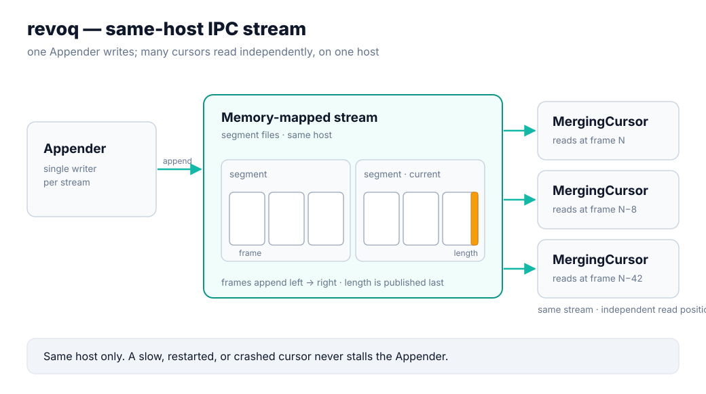
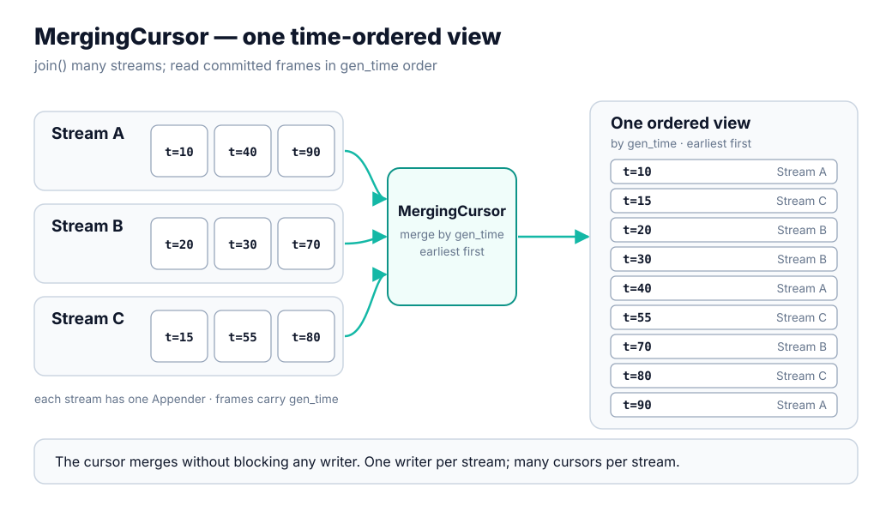

# revoq

[](https://github.com/revoracer/revoq/actions/workflows/ci.yml)
[](CHANGELOG.md)
[](#quick-start)
[](#quick-start)
[](LICENSE)

A file-backed, memory-mapped **IPC stream** for low-latency same-host messaging.

## At a glance

- Open-source transport primitive behind [RevoRacer](https://revoracer.com)
  infrastructure.
- Same-host IPC for market data, execution events, strategy signals, and
  telemetry.
- One hot-path writer per stream, many independent readers; slow readers do not
  stall the writer.
- Release/acquire publication: payload first, `length` last.
- C++23 core, optional Python bindings, Linux tuned path, Apache-2.0 license.

## Design limits

revoq targets one latency-sensitive producer publishing committed frames to
independent same-host consumers. The limits are intentional:

- **Not a network transport.** revoq is same-host IPC over mapped files.
- **Not lock-free MPSC.** The multi-writer policy serializes writers.
- **Not a latency guarantee on an untuned box.** Portable mode is for functional
  checks; the tail-latency story requires Linux, isolated cores, and hugepages.
- **Not yet API-stable.** This is `0.1.0`; signatures may still change.

## Architecture



`Appender` appends aligned frames to memory-mapped segment files;
`MergingCursor` joins streams and reads committed frames. Each frame carries
`length` (published last), message metadata, timestamps, and payload bytes.

A single `MergingCursor` can join several streams at once and present their
committed frames as one sequence ordered by `gen_time`, earliest first:



See [docs/architecture.md](docs/architecture.md),
[docs/memory_model.md](docs/memory_model.md), and
[docs/file_format.md](docs/file_format.md).

## Correctness

The core publication rule is tested directly: reserve a slot, fill metadata and
payload, release-store `length`; acquire-load `length`, then read the committed
frame.

Tests cover publication ordering, multiprocess handoff, resume/recovery, frame
and reader behavior, hugepages, typed dispatch, and Python round trips.

```bash
CXX=/usr/bin/clang++-20 ./build.sh test
```

## Quick start

Requirements: Linux (recommended for latency work), CMake ≥ 3.23, a C++23
compiler such as Clang 20, and Git submodules for the bundled deps (`fmt`,
`spdlog`, `Catch2`, `pybind11`).

```bash
CXX=/usr/bin/clang++-20 ./build.sh            # build
CXX=/usr/bin/clang++-20 ./build.sh test       # run C++ tests
CXX=/usr/bin/clang++-20 ./build.sh examples   # build C++ examples
CXX=/usr/bin/clang++-20 ./build.sh python     # build + test Python bindings
```

### Write and read (C++)

```cpp
using namespace racer::revoq;

struct Trade { std::int64_t ts; std::uint32_t symbol_id; double price; std::uint64_t qty; };

auto locator  = std::make_shared<Locator>(dir);
auto location = Location::make(Mode::LIVE, Category::EXECUTION, "examples", "demo", locator);

// writer: fill the slot, then publish
Appender<> writer(location, /*dest_id=*/0,
    AppenderOptions{.prefault = false, .background_threads = false});
auto &slot = writer.openData<Trade>(/*gen_time=*/1, MsgType::Trade);
slot = Trade{1, 101, 100.25, 10};
writer.closeData<Trade>();

// reader: walk committed frames
MergingCursor reader(MergingCursorOptions{.prefault = false, .background_threads = false});
reader.join(location, /*dest_id=*/0, 0);
while (const auto frame = reader.tryCurrentFrame()) {
  if (static_cast<MsgType>(frame.msg_type) == MsgType::Trade)
    use(frame->data<Trade>());
  reader.advance(frame);
}
```

### Write and read (Python)

```python
import revoq, struct
location = revoq.make_location(path, mode="live", category="executiondata",
                               group="examples", name="demo")

writer = revoq.Appender(location, 0, prefault=False, background_threads=False)
writer.write(msg_type=100, gen_time=1, data=struct.pack("<Qd", 1, 100.0))
del writer

reader = revoq.MergingCursor(prefault=False, background_threads=False)
reader.join(location, 0, 0)
frames = [f for f in reader if f.msg_type == 100]
```

Runnable versions live in [`examples/`](examples). Each C++ example exits nonzero
on failure and prints an `ok ...` line on success.

## Benchmarking

The latency benchmark has two modes, and is deliberate about what each one is
allowed to claim.

The tuned path uses four isolated roles: appender, cursor, appender warmer, and
cursor warmer. Low-latency claims without the machine capture are not useful.

**Portable mode** — no root, no pinning, no hugepages. Good for functional checks
and rough local comparisons. *Not* a source of host-to-host p99 claims.

```bash
CXX=/usr/bin/clang++-20 ./build.sh benchmarks
./build/revoq_benchmark_stream_handler_benchmark_p99 \
  --messages 1000000 --warmup 50000 --interval-ns 1000
```

**Tuned mode** — Linux only: explicit appender/cursor/warmer CPUs, real-time
priority, a `hugetlbfs` path, and a forked cursor process. Before your first
tuned run, prepare the host with `scripts/setup_benchmark_session.sh` — see
[docs/tuning_overview.md](docs/tuning_overview.md).

```bash
sudo ./build/revoq_benchmark_stream_handler_benchmark_p99 \
  --tuned --fork \
  --path /dev/hugepages/revoq-bench \
  --appender-cpu 2 --cursor-cpu 4 \
  --appender-warmer-cpu 6 --cursor-warmer-cpu 8 \
  --rt-priority 80 \
  --messages 100000000 --warmup 50000 --interval-ns 100
```

**What is measured:** appender timestamp to cursor handler endpoint, over a
deterministic mix of four 32-byte payloads. The benchmark reports the
distribution — `p50`, `p90`, `p99`, `p999`, `max`, and `mean` in nanoseconds —
plus sample count and a checksum, because in this domain the tail is the number
that matters, not the average.

### Reference results

> [!NOTE]
> Refresh the reference numbers with the four-role tuned topology before publishing.
> Do not reuse older shared-warmer results.

Reproduce the run with `./scripts/check_system.sh` and
`./scripts/collect_benchmark_env.sh`, and see
[docs/benchmarking.md](docs/benchmarking.md) and
[docs/tuning_overview.md](docs/tuning_overview.md) for the full methodology.

## Status

Early public release (`0.1.0`): C++23 memory-mapped stream core, C++ tests,
optional Python bindings, and the portable/tuned benchmark. The API may still
change — see [CHANGELOG.md](CHANGELOG.md).

## Commercial

revoq is open source so teams can inspect the memory model, file format,
benchmarks, and failure semantics. RevoRacer builds low-latency trading
infrastructure for hedge funds and trading teams.

We can help with revoq integration, benchmark reproduction on your hardware,
Linux host tuning, feed-handler and execution-gateway paths, and custom same-host
transport designs.

Contact us through [revoracer.com](https://revoracer.com). Details:
[docs/commercial_support.md](docs/commercial_support.md).

## License

Apache License 2.0. See [LICENSE](LICENSE) and [NOTICE](NOTICE).
